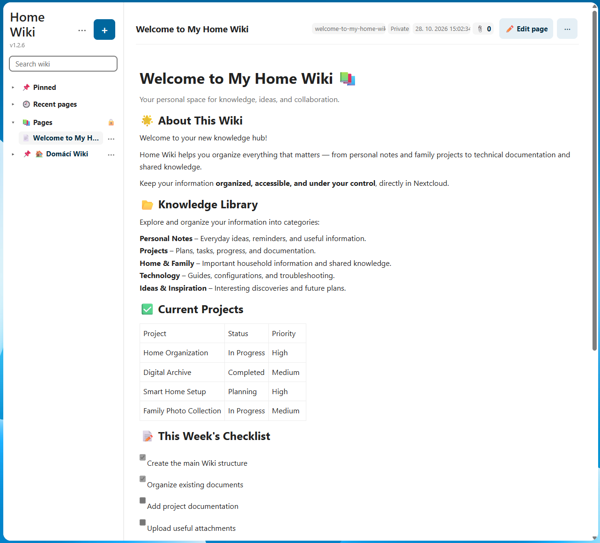
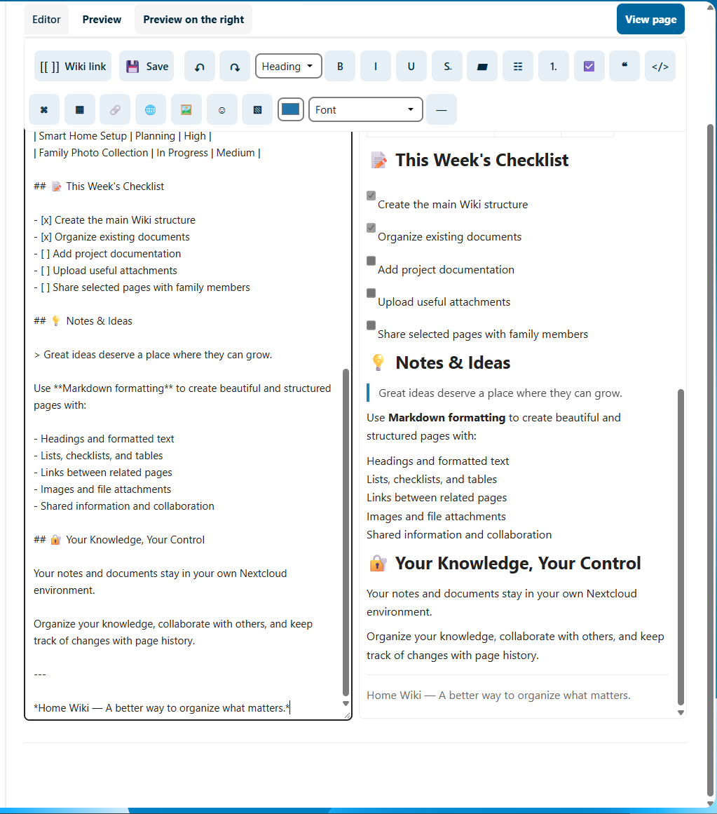

# Home Wiki 1.2.8

Home Wiki je Markdown Wiki pro **Nextcloud 35**. Stránky, obrázky a přílohy se ukládají do Nextcloud Files vlastníka; databáze Nextcloudu uchovává strom stránek, sdílení, štítky, odkazy a další metadata.

## Ukázky





[English](README.md)

## Požadavky

- Nextcloud **35**
- PHP **8.3–8.5** s rozšířením ZIP
- MariaDB/MySQL přes databázový ovladač Nextcloudu `mysql`
- [HC Shared App Core](https://github.com/hacesoft/core) (`hc_shared_app_core`) **0.18.8 nebo novější**

## Instalace

### Nextcloud App Store

Pokud je Home Wiki dostupná v App Store vaší instance Nextcloudu, je toto doporučený způsob instalace. Nejprve nainstalujte a povolte **HC Shared App Core**, potom v **Aplikace** vyhledejte **Home Wiki** a zvolte instalaci/povolení.

### Ruční instalace

Ruční instalace je podporována pro správce, kteří nechtějí nebo nemohou použít App Store. Použijte hotový release archiv `hc_homewiki-<verze>.tar.gz` nebo `hc_homewiki-<verze>.zip`, nikoli celý zdrojový projekt.

Archiv obsahuje jediný kořenový adresář `hc_homewiki`. Umístěte jej do zapisovatelného adresáře aplikací Nextcloudu (typicky `custom_apps/hc_homewiki`), nastavte vlastnictví/oprávnění pro webový proces a aplikaci povolte přes `occ`:

```sh
sudo -u www-data php occ app:enable hc_homewiki
```

V Dockeru spusťte stejný příkaz uvnitř kontejneru Nextcloudu; například:

```sh
docker exec -u www-data <nextcloud-container> php /var/www/html/occ app:enable hc_homewiki
```

Přesný postup, včetně ruční aktualizace a kontroly instalace, je v [Instalace a aktualizace](docs/cz/INSTALACE.md).

### Instalace full-source balíku přes `install.sh`

Pro správce s Dockerovým nasazením Nextcloudu je v full-source balíku zachovaný také automatizovaný instalační postup. Po rozbalení full-source archivu spusťte z jeho kořene:

```sh
sudo sh install.sh
```

Skript ověří metadata aplikace, vyhledá běžící Nextcloud kontejnery, zkontroluje HC Shared App Core, připraví transakční zálohu předchozího runtime, nasadí nový kód, ověří databázové schéma a při selhání se pokusí obnovit předchozí runtime. Tento způsob je určen pro Dockerové instalace s dostupným příkazem `docker`; pro běžnou instalaci bez Dockeru použijte App Store nebo ruční instalaci release archivu.

## Hlavní funkce

- hierarchický strom stránek s drag-and-drop přesouváním,
- Markdown editor ze Shared App Core, živý náhled a automatické ukládání,
- ochrana proti souběžnému přepsání změn,
- soukromé stránky, sdílení s uživateli/skupinami a viditelnost pro všechny přihlášené uživatele,
- samostatná práva Read / Edit / Delete / Share a volitelné zobrazení práv ve stromu,
- trvalé dědění sdílení v podstromu a předání vlastnictví stránky/podstromu,
- Wiki odkazy, aliasy, zpětné odkazy a fulltext,
- připnuté, nedávné a často používané stránky, štítky a přílohy,
- historie verzí přes Nextcloud `files_versions`,
- Koš s volitelnou retencí,
- ZIP export/import celé Wiki a import Markdown/Markdown ZIP,
- volitelná navigace `← 🏠 →`, mobilní rozložení a uživatelské nastavení editoru,
- volitelná synchronizace posouvání Markdown zdroje a živého náhledu.

## Dokumentace

- [Instalace a aktualizace](docs/cz/INSTALACE.md)
- [Používání Home Wiki](docs/cz/POUZITI.md)
- [Data, oprávnění, Koš a zálohy](docs/cz/DATA_A_ZALOHY.md)
- [Formát exportu/importu a převod dat z jiných systémů](docs/cz/FORMAT_IMPORT_EXPORT.md)

## Zálohování

Před ruční aktualizací nebo větší změnou doporučujeme vytvořit nativní export Home Wiki a běžnou zálohu Nextcloudu. Uživatelský adresář `HomeWiki/` není součástí instalačního kódu aplikace a při aktualizaci se nesmí mazat.

## Jazyky

Čeština, angličtina, němčina, španělština, francouzština, italština, nizozemština, polština, portugalština (Portugalsko), slovenština a ukrajinština. Výchozí jazyk je angličtina.

## Licence

AGPL-3.0-or-later. Viz [LICENSE](LICENSE).

Historie vydání: [CHANGELOG.md](CHANGELOG.md). Český přehled: [CHANGELOG.cs.md](CHANGELOG.cs.md).
